  

### Lab

| Progetto | In una riga |
|---|---|
| [**GLTSegnaletica**](https://github.com/suonatorefelice/GLTSegnaletica) | Web app nata vulnerabile apposta, poi blindata: 20 falle chiuse, 9 security gate a ogni push |
| [**gestione-monitor**](https://github.com/suonatorefelice/gestione-monitor) | Controlla il monitor esterno dalla barra dei menu del Mac: protocollo DDC/CI rifatto in Swift |
| [**recon-stack**](https://github.com/suonatorefelice/recon-stack) | Plugin DevStack per OpenStack: scopre da solo i servizi attivi nel cloud, senza installare agenti |

### Toolkit

  
  
  
  
  

 

  

